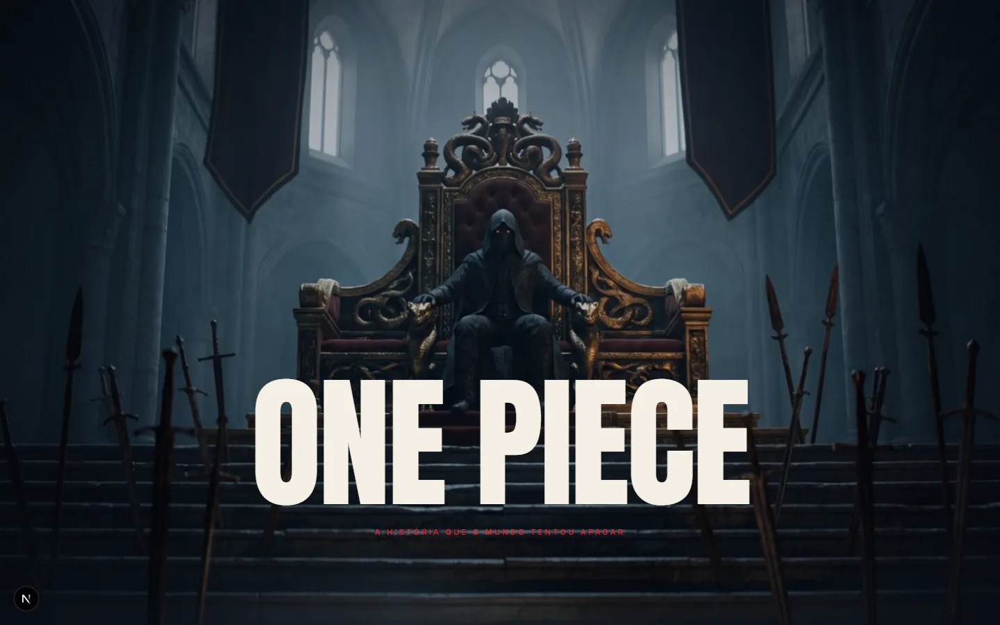

[English](README.md) · **Português**

# One Piece — A história que o mundo tentou apagar

Peça cinematográfica de página única sobre a história de One Piece. Uma cena
controlada pelo scroll abre o site, e a partir dela a página conta a jornada em
cinco capítulos — Execução, Tripulação, Rota, Guerras, Amanhecer — fechando
com uma vitrine das falas que ficaram.

> **Tipo:** fan-made — projeto de fã, sem fins comerciais e sem afiliação com
> Eiichiro Oda, Shueisha, Toei Animation ou qualquer detentor dos direitos de
> One Piece. Nenhum arquivo de logo oficial é usado: o título é composto em
> fonte comum (Anton). Não há demo pública confirmada.



## Stack

- **Next.js 16** (App Router) + TypeScript
- **Tailwind CSS 4**
- **GSAP 3** + ScrollTrigger para toda a animação
- **Lenis** para suavizar o scroll que alimenta o ScrollTrigger
- ESLint 9 (`eslint-config-next`)

Site estático — sem backend, banco ou API.

## Rodando

Pré-requisitos: Node.js 20.9+ (o CI usa Node 22) e npm.

```bash
npm ci
npm run dev
```

Em `http://localhost:3000`. Não há variáveis de ambiente.

Para conferir o desempenho de verdade, use o build de produção: em
desenvolvimento o otimizador de imagens processa as artes sob demanda e
disputa CPU com o navegador.

```bash
npm run build && npm run start
```

## Estrutura

```
src/app/                    home, /laugh-tale (a recompensa do SEGURE), tokens de cor e tipografia
src/components/hero/        ThroneHero — a cena de abertura — e suas camadas (ShotLayer)
src/components/chapter.tsx  ChapterSection — a faixa horizontal fixa de cada capítulo
src/components/chapter-extras.tsx  CrewPanel e MapPanel, os painéis extras de dois capítulos
src/components/intro.tsx    o manifesto de abertura
src/components/falas.tsx    a vitrine editorial das falas
src/components/site-shell.tsx, loader.tsx, nav.tsx, site-footer.tsx  casca do site
src/content/                os 5 capítulos, a tripulação, a rota e as falas
src/lib/                    timeline do hero, Lenis + ScrollTrigger, reveals, split de texto
scripts/                    redução das artes (downscale-art) e captura/gravação local (shoot, record)
public/art/                 ilustrações do manifesto e da vitrine de falas
public/shot/                fotos por capítulo (execucao, tripulacao, rota, guerras, amanhecer, cutout)
public/video/               2 planos do hero
public/laugh-tale/          o wallpaper da página secreta
docs/superpowers/specs/     os documentos de design que originaram o projeto
docs/screenshots/           imagem usada neste README
```

## Scripts

| Comando | O que faz |
| --- | --- |
| `npm run dev` | servidor de desenvolvimento |
| `npm run build` | build de produção (inclui checagem de tipos) |
| `npm run start` | serve o build de produção |
| `npm run lint` | ESLint |
| `node scripts/downscale-art.mjs` | reduz as artes de `public/art/` (usa `sharp`, instalado como dependência do Next) |
| `node scripts/shoot.mjs [url] [saída]` | capturas com Chromium headless (`puppeteer-core`) |
| `node scripts/record.mjs <realSec> <targetSec> <saída> [url]` | grava a jornada em vídeo (requer `ffmpeg`) |

Os scripts de captura usam por padrão o Edge no caminho padrão do Windows;
em outro sistema, aponte `BROWSER_PATH` para um Chromium instalado.

Cada capítulo é uma entrada em `CHAPTERS` (`src/content/chapters.ts`), renderizada
pelo mesmo `ChapterSection` em `src/app/page.tsx`. Trocar uma fala, uma ilha da
rota ou um tripulante não exige tocar em componente nenhum — só no conteúdo em
`src/content/`.

## Decisões que valem saber

**O palco das seções fixas usa `position: sticky`, não o `pin` do
ScrollTrigger.** Sticky não cria pin-spacer, não desloca o resto da página e
não depende de remedição depois que as imagens carregam.

**O Lenis só emite evento para o scroll que ele mesmo conduz.** Um scroll
programático — âncora, tecla Home, restauração de posição ao recarregar —
deixaria o ScrollTrigger com a posição antiga, então `src/lib/scroll.ts`
centraliza a instância única (`getLenis`/`setLenis`) e expõe `scrollToId`, que
sabe cair para `scrollIntoView` nativo quando o Lenis ainda não montou.

**As artes são reduzidas ao tamanho em que aparecem** (`scripts/downscale-art.mjs`).
Em 2K a página travava o renderizador do Chrome. Se novas artes forem
adicionadas, rode o script antes de commitar.

**Nada de `feTurbulence` em tela cheia.** Uma camada de grão de filme em SVG
sob `mix-blend-mode` travou o navegador por completo — está anotado em
`globals.css` para não voltar.

**`prefers-reduced-motion` é respeitado em toda seção animada**: o hero mostra
o quadro final sem scrub, os vídeos dão lugar às imagens estáticas, e as
galerias horizontais viram listas de scroll comum.

## Limitações

- Página única em português, sem testes automatizados.
- Mídias pesadas no repositório: 7 vídeos (`public/shot/*/full.mp4`,
  `public/video/eyes.mp4`, `public/video/throne.mp4`, de ~2,6 a ~8,3 MB).
- O `metadataBase` em `src/app/layout.tsx` é um placeholder, não um endereço
  publicado.

## Créditos e direitos de terceiros

One Piece e seus nomes, personagens e elementos são de Eiichiro Oda /
Shueisha / Toei Animation. Este é um trabalho de fã, sem fins comerciais e
sem afiliação ou endosso dos detentores dos direitos.

- **Ilustrações e fotos** (`public/art/`, `public/shot/`, `public/laugh-tale/`):
  geradas por IA, inspiradas na obra, segundo o autor (o script
  `downscale-art.mjs` cita o Higgsfield como origem das artes). Algumas
  retratam personagens e símbolos da obra, como a bandeira do bando do Chapéu
  de Palha (`public/art/flag.webp`).
- **Vídeos** (7 arquivos `.mp4`): origem não documentada. O documento de
  design previa gerá-los por IA (image-to-video), mas não há registro que
  confirme a origem nem a licença de uso.

Se você é detentor de direitos e quer a remoção de algum conteúdo, abra uma
issue.

## Segurança

Veja [SECURITY.md](SECURITY.md).

## Licença

Ainda não há licença definida; todos os direitos reservados ao autor. Isso
vale apenas para o código e o material original do autor — os direitos sobre
One Piece pertencem aos seus titulares.
